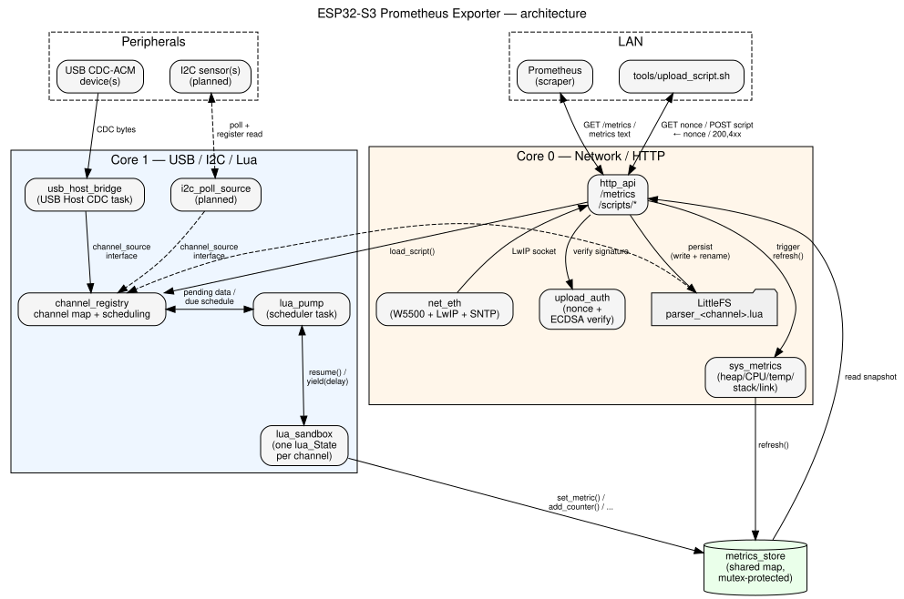

===========================
ESP32-S3 Prometheus Exporter
===========================

**Disclaimer: This is a personal project. The views, code, and opinions
expressed here are my own and do not represent those of my current or past
employers.**

.. contents::
   :local:
   :depth: 1

Status
======

**Work in progress.** The firmware boots, talks to peripherals over USB
Host and I²C, runs Lua parsers per channel, and serves Prometheus metrics
over Ethernet — but APIs, metric names, and the on-device configuration
format are still changing. Expect breakage between commits; there is no
stable release yet.

What this is
=============

A LAN-connected telemetry bridge for an ESP32-S3 board with Ethernet
(reference hardware: Waveshare ESP32-S3-ETH or any compatible
ESP32-S3 + W5500 board). It is meant for devices that speak an
unsupported or proprietary protocol — a USB-serial instrument, a one-off
I²C sensor — where writing a dedicated Prometheus exporter for each one
isn't worth it.

Instead of a C++ parser per device, each monitored channel gets a small
**Lua script** that turns raw bytes (from USB CDC-ACM) or a polled
register (from I²C) into named metric values. The exporter then serves
them on a Prometheus ``/metrics`` endpoint, same as any other exporter.

What it will do once finished
===============================

- **USB Host input**: read one or more USB CDC-ACM serial devices
  plugged into the board's native USB port.
- **I²C polling**: read registers from I²C peripherals on a schedule.
- **Per-channel Lua parsing**: a user-supplied script per channel turns
  raw input into named metric values, so adding a new device means
  writing a script, not firmware.
- **Prometheus ``/metrics`` over Ethernet**: scrape the board directly
  from Prometheus, no cloud dependency, no WiFi.
- **Script uploads**: push a new or updated Lua script to a channel
  over HTTP, optionally authenticated, without reflashing.
- **Diagnostics**: exporter-health and board-health metrics (chip
  temperature, per-channel Lua memory use, scheduler stall recovery)
  alongside the user-defined ones, so the exporter can tell you when
  it — or a channel — is unhealthy.

Non-goals
=========

- WiFi (Ethernet-only).
- Battery operation.
- Multi-tenant auth on the scrape endpoint (single-trust-domain LAN
  assumed).

Architecture
============

Two FreeRTOS tasks, pinned one per core, meet only at a shared,
mutex-protected metric map; the HTTP server never touches USB, I²C, or Lua
directly. See `DESIGN.md <DESIGN.md>`_ for the reasoning behind each piece.

         Core 0, meeting at a shared metrics_store.

Generated from `docs/architecture.dot <docs/architecture.dot>`_ — after
editing the source, regenerate with:

.. code:: sh

   dot -Tsvg docs/architecture.dot -o docs/architecture.svg

Building
========

1. Install `ESP-IDF v6.1 <https://docs.espressif.com/projects/esp-idf/en/stable/esp32s3/get-started/index.html>`_
   (follow Espressif's own instructions for your platform - this installs
   the toolchain and a dedicated Python virtual environment under
   ``~/.espressif``).
2. In every new shell, before building: ``. $IDF_PATH/export.sh`` (or
   wherever you installed it, e.g. ``~/esp/esp-idf/export.sh``). This puts
   ``idf.py`` on ``PATH``.
3. Build the firmware from the repo root: ``idf.py build``.
4. Run the Tier 1 host-native unit tests instead (DESIGN.md §12.2, no
   hardware or emulator needed): ``cd test/host && idf.py --preview
   set-target linux build && ./build/test_host.elf``.

No other manual setup step is needed: the one build-time-only Python
dependency the self-documentation endpoint uses (DESIGN.md §11.1) installs
itself into the same ESP-IDF-managed Python environment on first build.

More detail
===========

See `DESIGN.md <DESIGN.md>`_ for the full design: hardware, toolchain,
component layout, and the open questions still being worked through.

License
=======

Apache License 2.0 — see `LICENSE <LICENSE>`_.
